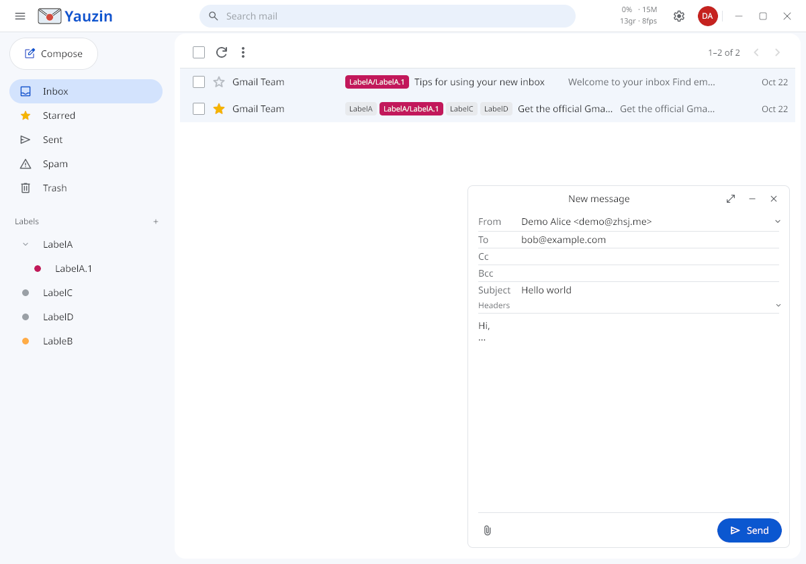

# Yauzin

**English** | [简体中文](README.zh-CN.md)

A Linux desktop email client in Go + [Gio](https://gioui.org).



## Highlights

- **Gmail-native**: labels, archive and search go through the Gmail API, not IMAP.
- **Send As replacement**: Gmail [retires Send As in January 2027](https://support.google.com/mail/answer/17101213).

## Install

```bash
flatpak remote-add --if-not-exists --user --no-gpg-verify \
  yauzin oci+https://zhsj.github.io/yauzin
flatpak install --user yauzin me.zhsj.yauzin
```

## Notes

- Needs your own Google Cloud OAuth client with the Gmail API enabled.

## License

[MIT](LICENSE)
